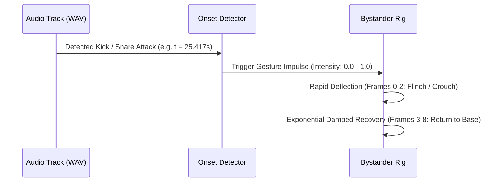

# Bystander Scale Anchoring, Wheel Kinematics & Reaction Cues

## 1. Scale Hierarchy & Proportional Rules (`bystander-scale.cjs`)

To ground the visual comedy in authentic physical dimensions while accommodating cinematic close-ups, **Big Tex: Rewired** uses a two-tier scale model:

### The 55-Foot Tex Anchor
In the physical world, [Big Tex stands 55 feet tall](https://bigtex.com/about-us/big-tex/). An average adult stands 6 feet tall, yielding a strict physical scale factor:

$$\text{Scale Ratio} = \frac{55\text{ ft}}{6\text{ ft}} \approx 9.167$$

$$\text{Adult Height} = \frac{\text{Tex Height}}{9.167} \approx 0.1091 \times \text{Tex Height}$$

### Measurement & Application
1. **Full-Figure Shots:** When Big Tex is shown full-body (boots on ground, hat tip visible), adult bystanders are scaled precisely to $10.9\%$ of Big Tex's measured bounding box (sole-to-hat apex).
2. **Pediatric & Seated Modifiers:**
   - *Child (Balloon Kid / Family Child):* Scaled to $60\%$ of adult reference height ($3.6\text{ ft}$ equivalent).
   - *Wheelchair Athlete (`rolling-out`):* Seated eye-line placed at $70\%$ of adult reference height.
   - *Driver in Car (`i30-driver`):* Placed within vehicle cockpit at $75\%$ seated scale.
3. **Foreground Reaction Shots:** When the camera pulls in for comedic character reactions (e.g. Phone Filmer flinching, Snack Protector sheltering corny dog), the bystander is positioned on the immediate foreground plane, decoupled from Tex's distant depth to ensure gesture readability on mobile displays.

---

## 2. Wheel Kinematics & Rolling Mechanics

All circular wheels across both props and fairgoers obey continuous no-slip rolling kinematics:

$$\Delta \theta = \frac{\Delta x}{r}$$

Where:
- $\Delta \theta$ is the angular rotation in radians.
- $\Delta x$ is the linear translation distance along the horizontal plane.
- $r$ is the effective wheel radius in SVG coordinate space.

### Physical Entities:
1. **Texas Star Ferris Wheel:**
   - Nominal rim radius: $r = 96\text{ units}$.
   - Hub center: Pivot anchored at hub center $(128, 128)$.
   - Direction: Clockwise when rolling to the right ($\Delta x > 0$), counter-clockwise when rolling left.
2. **Stroller & Cart Wheels:**
   - Stroller front wheel: $r = 18\text{ units}$.
   - Stroller rear wheel: $r = 22\text{ units}$.
   - Corny Dog Vendor cart wheel: $r = 34\text{ units}$.
3. **Wheelchair Athlete (`rolling-out`):**
   - Drive wheel: $r = 42\text{ units}$; rotates relative to wheelchair chassis travel.
   - Hand rim: Angular speed matches drive wheel with periodic arm propulsion strokes.

---

## 3. Score-Driven Attack Recoil Mapping

Rather than using looping idle cycles, bystander reactions are event-driven, triggered directly by detected attacks in the soundtrack:

### Character Reaction Behaviors:
- **Phone Filmer:** Phone arm drops $15^\circ$ and torso leans back during hat impact; recovers to recording pose within 6 frames.
- **Snack Protector:** Torso crouches $20^\circ$ downward over the corny dog; protective arm pulls tight.
- **Balloon Kid:** Head tilts upward $35^\circ$; balloon oscillates with damped pendulum motion ($\omega = \sqrt{g/L}$).
- **I-30 Driver:** Both hands toss up from the steering wheel on loud brass stabs.
- **Coupon Collector:** Coupon fan pulls tight to chest with rapid elbow flex.

---

## 4. Protected Title Intervals

To prevent comic figures from cluttering the dramatic climax and title cards, all bystander rendering is strictly suppressed during designated title intervals:

| Cut | Protected Time Window | Enforced Content |
|---|---|---|
| **90-Second v03** | `73.500s – 76.875s` | **BIG TEX: REWIRED** Main Title Card |
| **90-Second v03** | `84.667s – 90.000s` | **KEEP YOUR CORNY DOG CLOSE** Outro Card |
| **30-Second Teaser**| `26.167s – 30.000s` | Final Title Hold through end frame |

The automated test runner in `verify.py` inspects decoded frames during these ranges to verify complete foreground clearance.
