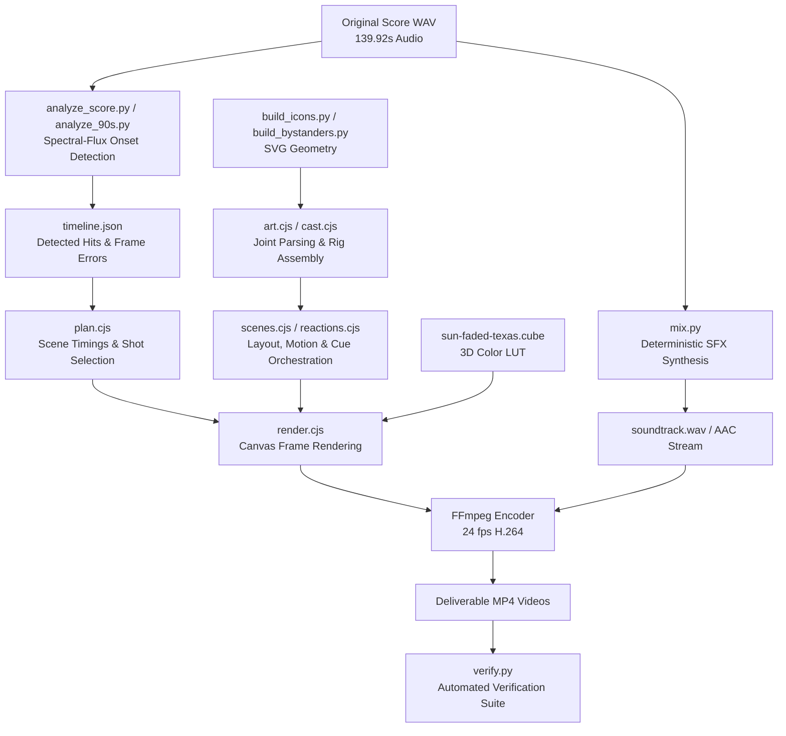

# Big Tex: Rewired — System Overview & Architecture

## 1. Executive Summary

**Big Tex: Rewired** (*State Fair: Maximum Voltage*) is an animated cut-paper comedy trailer and title sequence project. The narrative reimagines the State Fair of Texas as a colossal sci-fi monster showdown when Big Tex is struck by lightning and fuses with the Dallas electrical grid.

This document details the software architecture, asset pipelines, rendering components, and mathematical models powering the animation engine.

---

## 2. Technical Stack

| Layer | Technologies | Rationale |
|---|---|---|
| **Vector Geometry** | SVG 1.1 / XML, Python Standard Library | Zero external vector dependencies; strict viewBox geometry, explicit fills, transparent negative space cutouts. |
| **Raster Engine** | `@napi-rs/canvas`, Node.js | High-performance, headless Skia-backed 2D drawing supporting complex SVG path rendering, matrix transformations, and blend modes. |
| **Signal Processing** | Python 3, NumPy, SciPy | Automated spectral-flux onset detection extracting rhythmic attacks directly from uncompressed 44.1 kHz WAV audio. |
| **Sound Synthesis** | Python 3, Wave, NumPy | Deterministic local synthesis of sub-bass rumbles, mechanical impacts, electrical arcing, and swooshes without external samples. |
| **Color Grading** | 33-point 3D LUT (`.cube`), Python PIL | Precision color remapping from primary inks into a sun-bleached Texas carnival palette. |
| **Video Encoding** | FFmpeg (CLI) | Broadcast-standard 24 fps H.264 video with 320 kbps stereo AAC audio encoding and zero frame drift. |
| **Verification** | Python 3, FFprobe, Pillow | Headless stream validation, bit-identical audio SHA-256 checking, and contact sheet generation. |

---

## 3. Directory Layout & Core Modules

```
big-tex/
├── trailer--v0.1.md                  # Narrative script & 90-second beat breakdown
├── trailer--suno.md                  # Music generation prompt, structure & outlaw lyrics
├── assets/
│   ├── title-sequence/               # 12 Saul Bass cut-paper SVG silhouettes
│   │   ├── icons/                    # Standalone 256x256 SVGs
│   │   ├── build_icons.py            # Standard-library SVG generator
│   │   ├── contact-sheet.svg         # Grid preview of icons
│   │   └── sprite.svg                # Master reusable symbol bundle
│   └── bystanders/                   # 12 articulated crowd figures
│       ├── icons/                    # Sun-faded color variant
│       ├── classic/                  # Classic black/red/gold variant
│       ├── animation-parts.json      # Rigging manifests and pivot coordinates
│       ├── build_bystanders.py       # Algorithmic geometry builder
│       └── palette.json              # Swatch definitions
├── animation/
│   ├── render_sequence.cjs           # v01 full 139.92s title sequence renderer
│   ├── render_90s.cjs                # v02 90s hit cut renderer
│   ├── render_teaser.cjs             # v03 30s teaser renderer
│   ├── analyze_score.py              # Waveform attack extraction
│   ├── analyze_90s.py                # 90s spectral-flux cut planner
│   ├── plan_teaser.cjs               # 30s teaser hit alignment
│   └── v3/                           # Modern modular animation pipeline
│       ├── art.cjs                   # Jointed Big Tex puppet & vector graphics
│       ├── scenes.cjs                # 47-shot staging, comedy cards & rolling physics
│       ├── plan.cjs                  # Edit planner using waveform hit evidence
│       ├── mix.py                    # 90s audio mix & synthesized sound effects
│       ├── bystander-scale.cjs       # Mathematical scale anchor (55ft / 6ft)
│       ├── teaser-30s/               # 30-second vertical teaser cut
│       └── bystanders/               # Full 90s wide & vertical crowd integration
└── docs/                             # Engineering specifications & guides
```

---

## 4. Execution Workflow

The end-to-end production pipeline follows a structured, deterministic flow:



---

## 5. Submodule Policy & Repository Cleanliness

This repository contains **zero submodules** and no external git dependencies. All code, vector assets, and build tools are self-contained within this tree.

To maintain git hygiene:
- Media artifacts (`*.wav`, `*.mp3`, `*.mp4`, `*.m4a`, `*.jpg`, `*.jpeg`, `*.png`, `*.zip`) and OS metadata (`.DS_Store`) are excluded via `.gitignore`.
- Renderers produce intermediate frames in memory or local temporary buffers, streaming directly to FFmpeg to avoid disk pollution.
- All SVG assets and data manifests remain version-controlled as source files.
